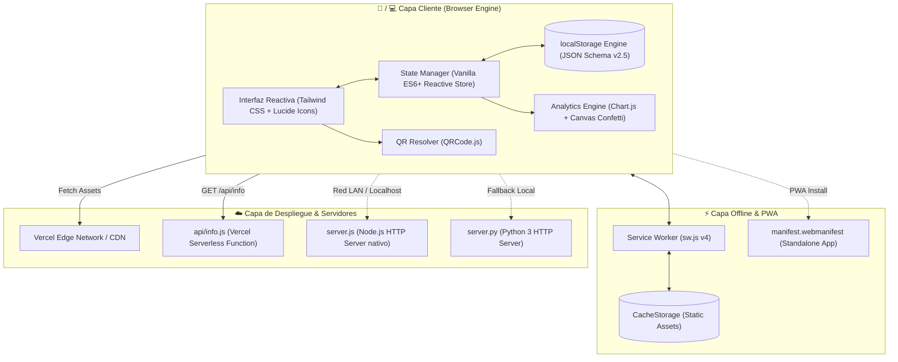

# 💰 FinanzasPro — Arquitectura Técnica y Manual de Despliegue

[](package.json)
[](manifest.webmanifest)
[](#compatibilidad)
[](vercel.json)
[](LICENSE)

**FinanzasPro** es una aplicación progresiva (**Progressive Web App - PWA**) de finanzas personales orientada a privacidad (*Local-First*), diseñada específicamente para operar de manera reactiva, persistente y sin dependencias pesadas en entornos **Microsoft Windows** y dispositivos móviles **Android**.

---

## 📑 Tabla de Contenidos

1. [Arquitectura del Sistema](#-arquitectura-del-sistema)
2. [Modelos de Datos y Esquemas JSON](#-modelos-de-datos-y-esquemas-json)
3. [Motor Financiero y Conciliación Contable](#-motor-financiero-y-conciliación-contable)
4. [Estrategia PWA, Cache y Modo Sin Conexión](#-estrategia-pwa-cache-y-modo-sin-conexión)
5. [Despliegue en Vercel](#-despliegue-en-vercel)
6. [Cómo Iniciar y Ejecutar la Aplicación](#-cómo-iniciar-y-ejecutar-la-aplicación)
7. [Módulos y Estructura del Código](#-módulos-y-estructura-del-código)
8. [Privacidad, Exportación y Respaldos](#-privacidad-exportación-y-respaldos)
9. [Compatibilidad de Navegadores](#-compatibilidad-de-navegadores)

---

## 🏛 Arquitectura del Sistema

El software implementa un patrón **Local-First / Single Page Application (SPA)** desacoplado con persistencia cliente-side garantizada mediante Web Storage API (`localStorage`), complementado con un Service Worker de ciclo de vida controlado y un backend serverless mínimo para resolución de red y metadatos.



### Principios Arquitectónicos
- **Cero Dependencias Nativas de Compilación:** No utiliza binarios C++ compilados (`.node`), garantizando compatibilidad total con directivas de seguridad corporativa como **Windows AppLocker** y **Windows Defender Application Control (WDAC)**.
- **Local-First & Privacidad Absoluta:** Los registros contables no transitan por servidores de terceros ni bases de datos remotas. El usuario mantiene soberanía absoluta de sus activos de datos.
- **Reactividad Ligera:** Renderizado dinámico mediante mutaciones quirúrgicas del DOM, eliminando la sobrecarga de virtual DOM de frameworks pesados.

---

## 📊 Modelos de Datos y Esquemas JSON

El estado maestro reside bajo la llave `finanzas_pro_data_v2` en `localStorage`.

### 1. Modelo de Transacción (`Transaction`)
```typescript
interface Transaction {
  id: string;                      // Identificador único (timestamp alfanumérico)
  type: "income" | "expense";      // Naturaleza del movimiento contable
  amount: number;                  // Monto en moneda Pesos ($)
  category: string;                // Identificador de categoría (ej. "vivienda", "alimentacion")
  description: string;             // Concepto o glosa de la transacción
  date: string;                    // Fecha ISO en formato "YYYY-MM-DD"
  paymentMethod: string;           // "efectivo" | "debito" | "credito" | "transferencia"
  notes?: string;                  // Observaciones opcionales
  sourceExpenseId?: string;        // ID de Gasto Fijo asociado (si proviene de un abono o pago)
  createdAt: string;               // Marca de tiempo ISO 8601 de creación
}
```

### 2. Modelo de Gasto Fijo (`FixedExpense`)
Permite registrar compromisos recurrentes, soportando liquidaciones totales y abonos parciales escalonados con fecha independiente:

```typescript
interface PaymentRecord {
  id: string;                      // Identificador del abono
  amount: number;                  // Monto abonado en pesos
  paymentDate: string;             // Fecha en la que se efectuó el pago ("YYYY-MM-DD")
  isFull: boolean;                 // Flag de liquidación completa
  notes?: string;                  // Detalle opcional del abono
  registeredAt: string;            // Registro de auditoría temporal
}

interface FixedExpense {
  id: string;                      // Identificador del compromiso
  name: string;                    // Nombre de la obligación (ej. "Arriendo", "Internet Fibra")
  amount: number;                  // Monto total estipulado a pagar en el período
  category: string;                // Categoría contable asociada
  dueDay: number;                  // Día del mes de vencimiento (1 - 31)
  notes?: string;                  // Detalles complementarios
  paidMonths: string[];            // Lista de meses marcados como 100% liquidados ("YYYY-MM")
  paymentsHistory?: {
    [monthKey: string]: PaymentRecord[]; // Historial detallado de abonos por mes ("YYYY-MM")
  };
}
```

### 3. Modelo de Metas de Ahorro (`Goal`)
```typescript
interface Goal {
  id: string;
  title: string;                   // Nombre de la meta (ej. "Fondo de Emergencia")
  targetAmount: number;            // Monto objetivo en pesos
  currentAmount: number;           // Monto actualmente acumulado
  deadline: string;                // Fecha límite estimada ("YYYY-MM-DD")
  category: string;                // Clasificación
  icon: string;                    // Identificador visual de icono
  color: string;                   // Código hexadecimal o clase de color
  history: Array<{
    type: "deposit" | "withdraw";
    amount: number;
    date: string;
  }>;
}
```

### 4. Modelo de Presupuestos y Límites (`Budget`)
```typescript
interface Budget {
  globalLimit: number;             // Límite mensual global en pesos
  categoryLimits: {
    [category: string]: number;    // Monto tope asignado por categoría individual
  };
}
```

---

## 🧮 Motor Financiero y Conciliación Contable

### 1. Cálculo de Balance Periódico
Para cualquier período mensual seleccionado (`YYYY-MM`):
$$\text{Ingresos} = \sum \text{Transaction}_{\text{type} = \text{income}}$$
$$\text{Gastos} = \sum \text{Transaction}_{\text{type} = \text{expense}}$$
$$\text{Balance Neto} = \text{Ingresos} - \text{Gastos}$$
$$\text{Tasa de Ahorro (\%)} = \left( \frac{\text{Balance Neto}}{\text{Ingresos}} \right) \times 100 \quad (\text{si Ingresos} > 0)$$

### 2. Conciliación de Gastos Fijos y Abonos Parciales
El sistema implementa conciliación automática bidireccional:
- Cuando el usuario efectúa un **abono parcial** o **pago total** en el módulo de Gastos Fijos:
  1. Se calcula el acumulado abonado para el mes activo:
     $$\text{Abonado} = \sum_{r \in \text{paymentsHistory}[month]} r.\text{amount}$$
  2. Si $\text{Abonado} \ge \text{amount}$, el compromiso se marca automáticamente como **Pagado** en `paidMonths`.
  3. Se genera de forma atómica una transacción de tipo `expense` en la tabla principal con `sourceExpenseId = fixedExpense.id`, garantizando que el egreso impacte de inmediato en el balance mensual, gráficos de consumo y presupuestos.
  4. Si se elimina o revierte un abono, la transacción espejo se concilia y revierte congruentemente.

---

## ⚡ Estrategia PWA, Cache y Modo Sin Conexión

### 1. Service Worker (`sw.js`)
Configurado bajo la estrategia **Network-First con Fallback a Cache (`finanzas-pro-v4`)**:
- Las solicitudes de recursos intentan primero consultar la red para recibir actualizaciones instantáneas.
- En ausencia de conexión (modo offline en Android o Windows), el Service Worker intercepta la petición y sirve el recurso desde `CacheStorage`.
- En el evento `activate`, purga automáticamente versiones obsoletas del caché (`finanzas-pro-v1` a `v3`), evitando que el usuario conserve código desactualizado.

### 2. Manifiesto Web (`manifest.webmanifest`)
- `display: standalone`: Ejecución sin barra de direcciones de navegador (sensación de app nativa).
- `display_override: ["window-controls-overlay", "standalone"]`: Aprovechamiento del área de barra de título en Windows 11.
- `orientation: portrait-primary`: Orientación ergonómica por defecto en Android con soporte responsivo para modo escritorio en Windows.

### 3. Modo 100% Autónomo: `FinanzasPro_Movil.html`
Para escenarios donde el usuario requiere ejecutar la app en Android sin internet ni servidores:
- El script de compilación `build-mobile.js` fusiona `index.html` y `app.js` en un único archivo autónomo de **184 KB**.
- Puede enviarse por WhatsApp, Telegram o cable USB y abrirse directamente en Google Chrome o Microsoft Edge en Android.

---

## 🚀 Despliegue en Vercel

FinanzasPro está preconfigurada con optimizaciones nativas para **Vercel** (`vercel.json` y función serverless en `api/info.js`).

### Estructura de Configuración de Vercel (`vercel.json`)
```json
{
  "$schema": "https://openapi.vercel.sh/vercel.json",
  "version": 2,
  "framework": null,
  "buildCommand": "node build-mobile.js",
  "outputDirectory": ".",
  "cleanUrls": true,
  "headers": [
    {
      "source": "/sw.js",
      "headers": [
        { "key": "Cache-Control", "value": "public, max-age=0, must-revalidate" },
        { "key": "Service-Worker-Allowed", "value": "/" }
      ]
    },
    {
      "source": "/app.js",
      "headers": [
        { "key": "Cache-Control", "value": "no-cache, no-store, must-revalidate" }
      ]
    },
    {
      "source": "/manifest.webmanifest",
      "headers": [
        { "key": "Content-Type", "value": "application/manifest+json; charset=utf-8" },
        { "key": "Cache-Control", "value": "public, max-age=3600" }
      ]
    }
  ]
}
```

### Método A: Despliegue con Vercel CLI (Línea de Comandos)

1. Abre tu terminal (PowerShell o CMD) en la carpeta del proyecto:
   ```powershell
   cd C:\Users\PLC\.gemini\antigravity\scratch\finanzas-app
   ```
2. Inicia sesión en tu cuenta de Vercel (si no lo has hecho):
   ```bash
   npx vercel login
   ```
3. Ejecuta el comando de despliegue a producción:
   ```bash
   npm run deploy
   # O directamente:
   npx vercel --prod
   ```
4. Responde las preguntas interactivas de Vercel:
   - `Set up and deploy?` → **Y**
   - `Which scope do you want to deploy to?` → Selecciona tu cuenta
   - `Link to existing project?` → **N** (o Y si ya creaste el proyecto en el dashboard)
   - `What's your project's name?` → `finanzas-pro` (o presiona Enter)
   - `In which directory is your code located?` → `./`
5. ¡Listo! Vercel te proporcionará una URL pública segura HTTPS (ej. `https://finanzas-pro.vercel.app`).

---

### Método B: Despliegue Continuo con GitHub

1. Realiza commit y sube tus cambios al repositorio remoto:
   ```bash
   git add .
   git commit -m "feat: preparar proyecto con PWA, gastos fijos y soporte Vercel"
   git push origin main
   ```
2. Ve a tu panel en [vercel.com](https://vercel.com) e inicia sesión.
3. Haz clic en **"Add New..."** → **"Project"**.
4. Selecciona tu repositorio de GitHub `finanzas` (`ricardommorenom886-collab/finanzas`).
5. En la configuración de importación:
   - **Framework Preset**: Selecciona **Other** (el archivo `vercel.json` se encarga automáticamente).
   - **Build Command**: `node build-mobile.js` (o déjalo por defecto).
   - **Output Directory**: `./`
6. Haz clic en **Deploy**. Cada vez que hagas `git push`, Vercel compilará y actualizará la aplicación automáticamente con SSL global.

---

## 💻 Cómo Iniciar y Ejecutar la Aplicación

### 1. En Microsoft Windows (Uso Local)

#### Opción 1: Acceso Directo con 1 Clic
Haz doble clic sobre el archivo **`iniciar.bat`**. Se abrirá una ventana de consola y tu navegador predeterminado en `http://localhost:3000`.

#### Opción 2: Desde Terminal (Node.js)
```bash
npm start
# O:
node server.js
```

#### Opción 3: Servidor de Respaldo en Python
Si no tienes Node.js en otra máquina o prefieres Python:
```bash
python server.py
# O:
npm run python
```

---

### 2. Cómo Conectar tu Celular Android

FinanzasPro cuenta con un resolvedor de red LAN integrado en `server.js` y `api/info.js`:

1. Asegúrate de que tu PC y tu teléfono Android estén en la **misma red Wi-Fi**.
2. Inicia el servidor en tu PC (`iniciar.bat` o `npm start`).
3. En la barra superior de la app en tu PC, haz clic en el botón **"Móvil"**.
4. Aparecerá una ventana con un **código QR dinámico** generado con la IP local de tu red (ej. `http://192.168.1.15:3000`).
5. Abre la cámara de tu teléfono Android y escanea el código QR.
6. **Instalar en Android:** En Google Chrome en tu celular, pulsa el menú (⋮) y selecciona **"Instalar aplicación"** o **"Agregar a la pantalla principal"**.

---

## 📂 Módulos y Estructura del Código

```
finanzas-app/
├── api/
│   └── info.js               # Función Serverless Vercel (resolución de IP y health check)
├── icons/
│   ├── icon.svg              # Ícono vectorial oficial PWA en alta definición
│   └── icon-192.png          # Ícono rasterizado para homescreen Android
├── app.js                    # Núcleo de lógica financiera, controladores y persistencia (ES6+)
├── index.html                # Estructura SPA semántica, Tailwind CSS y modales
├── sw.js                     # Service Worker PWA (Estrategia Network-First v4)
├── manifest.webmanifest      # Manifiesto PWA para instalación en Windows y Android
├── build-mobile.js           # Transpilador/Inliner a archivo único autónomo
├── FinanzasPro_Movil.html    # Versión single-file 100% offline para Android
├── server.js                 # Servidor HTTP Node.js puro con auto-detección de IP LAN
├── server.py                 # Servidor HTTP Python 3 alternativo
├── iniciar.bat               # Lanzador con 1 clic para Microsoft Windows
├── compartir-celular.bat     # Asistente de vinculación Wi-Fi para Android
├── vercel.json               # Configuración de rutas, cabeceras y compilación para Vercel
├── package.json              # Metadatos del proyecto y scripts de ciclo de vida
└── README.md                 # Especificación técnica del sistema
```

---

## 🔒 Privacidad, Exportación y Respaldos

- **Zero-Knowledge Architecture:** No existen cookies de rastreo, analíticas de terceros ni sincronización en la nube no consentida.
- **Respaldo Completo (JSON):** Desde la sección *Ajustes*, el usuario puede generar un volcado íntegro de sus datos para transferirlo entre su computadora con Windows y su teléfono Android.
- **Exportación Contable (CSV):** Generación de archivos de hoja de cálculo delimitados por comas compatibles con **Microsoft Excel** y Google Sheets.

---

## 🌐 Compatibilidad de Navegadores

| Plataforma | Navegador Soportado | Instalable como App (PWA) | Modo Offline |
| :--- | :--- | :---: | :---: |
| **Microsoft Windows 10/11** | Microsoft Edge 90+ | ✅ Sí (Escritorio nativo) | ✅ Sí |
| **Microsoft Windows 10/11** | Google Chrome 90+ | ✅ Sí | ✅ Sí |
| **Microsoft Windows 10/11** | Mozilla Firefox 95+ | ⚠️ Como marcador web | ✅ Sí |
| **Android 8.0+** | Google Chrome Mobile | ✅ Sí (APK/WebAPK nativo) | ✅ Sí |
| **Android 8.0+** | Samsung Internet | ✅ Sí | ✅ Sí |
| **Android 8.0+** | Microsoft Edge Mobile | ✅ Sí | ✅ Sí |
| **Cualquier SO** | Sin navegador / Sin server | ✅ Vía `FinanzasPro_Movil.html` | ✅ Sí (100%) |

---

<p align="center">
  Desarrollado con arquitectura moderna, segura y privada para control financiero integral en Windows y Android.
</p>
